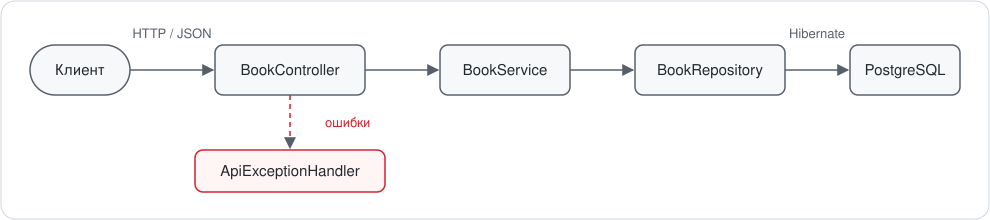

<div align="center">

# 📚 Book Catalog

**REST-сервис каталога книг для библиотеки**

Учёт книг, быстрый поиск и фильтрация по параметрам, пагинация и сортировка.


</div>

---

## 📖 О проекте

Сервис хранит каталог книг библиотеки и предоставляет REST API для работы с ним. Через API можно добавлять книги, просматривать и редактировать карточки, удалять записи и искать нужные издания по автору, названию, жанру, цене и году издания.

**Возможности**

- ✅ CRUD-операции над книгами
- 🔎 Динамическая фильтрация: любое сочетание параметров, пустые игнорируются
- 📄 Пагинация и сортировка по любому полю
- 🛡️ Валидация входных данных с понятным списком ошибок по полям
- 🚦 Единый формат ошибок по стандарту RFC 9457 (`ProblemDetail`)
- 🔑 Уникальность ISBN на уровне базы данных

## 🧰 Технологии

| Слой | Технология |
|---|---|
| Язык | Java 21+ |
| Фреймворк | Spring Boot 3.5 (Web, Data JPA, Validation) |
| ORM | Hibernate / JPA, Spring Data JPA Specifications |
| База данных | PostgreSQL |
| Сборка | Maven |
| Вспомогательно | Lombok, Docker Compose |

## 🏗️ Архитектура

<div align="center">
  
</div>

Слои разделены по ответственности:

- **web**: принимает запросы, проверяет данные (`@Valid`), обрабатывает ошибки.
- **service**: бизнес-логика и границы транзакций.
- **repository**: доступ к данным через Spring Data JPA.
- **dto**: объекты запросов и ответов, чтобы наружу не уходила сущность БД.
- **domain**: JPA-сущность `Book`.

### Структура проекта

```
book-catalog
├── docker-compose.yml
├── pom.xml
└── src/main
    ├── java/ru/itmo/catalog
    │   ├── CatalogApplication.java       точка входа
    │   ├── domain/Book.java              сущность
    │   ├── dto/
    │   │   ├── BookRequest.java          тело POST / PUT + валидация
    │   │   ├── BookResponse.java         ответ API
    │   │   └── BookFilter.java           параметры фильтрации
    │   ├── repository/BookRepository.java
    │   ├── service/BookService.java
    │   └── web/
    │       ├── BookController.java
    │       └── ApiExceptionHandler.java
    └── resources/application.yml
```

## ✅ Требования

- **JDK 21 или новее** (проверка: `java -version`)
- **Maven 3.9+** (проверка: `mvn -v`) или IntelliJ IDEA со встроенным Maven
- **PostgreSQL 14+** локально **или** Docker с Docker Compose

## 🚀 Быстрый старт

### 1. Подготовь базу данных

Выбери один из вариантов.

<details open>
<summary><b>Вариант A. Локальный PostgreSQL</b></summary>

Создай пользователя и базу:

```bash
psql postgres -c "CREATE ROLE catalog LOGIN PASSWORD 'catalog';"
psql postgres -c "CREATE DATABASE catalog OWNER catalog;"
```

Первая команда создаёт пользователя `catalog` с паролем `catalog`, вторая базу `catalog`, владельцем которой он становится.

</details>

<details>
<summary><b>Вариант B. Docker</b></summary>

Запусти Docker Desktop, дождись полной загрузки и выполни в корне проекта:

```bash
docker compose up -d
```

Контейнер создаст базу `catalog` и пользователя `catalog` с паролем `catalog`.

> ⚠️ Если порт `5432` уже занят локальным PostgreSQL, измени в `docker-compose.yml` проброс на `"5433:5432"`, а в `application.yml` порт в URL на `5433`.

</details>

### 2. Запусти приложение

```bash
mvn spring-boot:run
```

Или из IntelliJ IDEA: открой `CatalogApplication` и нажми ▶ рядом с `main`.

Сервис будет доступен на **http://localhost:8080**. Таблица `books` создаётся автоматически при первом запуске.

### 3. Проверь, что всё работает

```bash
curl http://localhost:8080/api/books
```

В ответ придёт пустая страница каталога.

### Сборка в jar

```bash
mvn clean package
java -jar target/book-catalog-1.0.0.jar
```

## ⚙️ Конфигурация

Настройки лежат в `src/main/resources/application.yml`:

| Параметр | Значение по умолчанию |
|---|---|
| `spring.datasource.url` | `jdbc:postgresql://localhost:5432/catalog` |
| `spring.datasource.username` | `catalog` |
| `spring.datasource.password` | `catalog` |
| `spring.jpa.hibernate.ddl-auto` | `update` |
| `server.port` | `8080` (по умолчанию Spring Boot) |

Любой параметр можно переопределить переменной окружения без правки файла:

```bash
SPRING_DATASOURCE_URL=jdbc:postgresql://localhost:5433/catalog \
SPRING_DATASOURCE_PASSWORD=secret \
SERVER_PORT=9090 \
mvn spring-boot:run
```

## 📡 API

Базовый путь: `/api/books`

| Метод | Путь | Описание | Успешный ответ |
|---|---|---|---|
| `GET` | `/api/books` | Список книг с фильтрами, пагинацией и сортировкой | `200` |
| `GET` | `/api/books/{id}` | Книга по идентификатору | `200` |
| `POST` | `/api/books` | Добавить книгу | `201` |
| `PUT` | `/api/books/{id}` | Полностью обновить книгу | `200` |
| `DELETE` | `/api/books/{id}` | Удалить книгу | `204` |

### Модель книги

| Поле | Тип | Обязательное | Правила |
|---|---|:---:|---|
| `id` | number | | Присваивается автоматически, в запросе не передаётся |
| `title` | string | ✅ | Не пустое |
| `author` | string | ✅ | Не пустое |
| `isbn` | string | | До 20 символов, **уникальный** |
| `genre` | string | | |
| `publicationYear` | number | | Не меньше 0 |
| `price` | number | ✅ | Не меньше 0, два знака после запятой |
| `stock` | number | | Не меньше 0, количество экземпляров |

### Создание книги

```bash
curl -X POST http://localhost:8080/api/books \
  -H "Content-Type: application/json" \
  -d '{
    "title": "Clean Code",
    "author": "Robert Martin",
    "isbn": "9780132350884",
    "genre": "Programming",
    "publicationYear": 2008,
    "price": 29.99,
    "stock": 10
  }'
```

Ответ `201 Created`:

```json
{
  "id": 1,
  "title": "Clean Code",
  "author": "Robert Martin",
  "isbn": "9780132350884",
  "genre": "Programming",
  "publicationYear": 2008,
  "price": 29.99,
  "stock": 10
}
```

### Получение, обновление, удаление

```bash
# одна книга
curl http://localhost:8080/api/books/1

# полное обновление (передаются все поля)
curl -X PUT http://localhost:8080/api/books/1 \
  -H "Content-Type: application/json" \
  -d '{"title":"Clean Code","author":"Robert Martin","isbn":"9780132350884",
       "genre":"Programming","publicationYear":2008,"price":24.99,"stock":7}'

# удаление
curl -X DELETE http://localhost:8080/api/books/1
```

### Поиск и фильтрация

Все параметры необязательные и комбинируются через «и».

| Параметр | Поведение | Пример |
|---|---|---|
| `title` | Подстрока в названии, без учёта регистра | `title=code` |
| `author` | Подстрока в имени автора, без учёта регистра | `author=martin` |
| `genre` | Точное совпадение жанра, без учёта регистра | `genre=programming` |
| `minPrice` | Цена не ниже значения | `minPrice=10` |
| `maxPrice` | Цена не выше значения | `maxPrice=50` |
| `yearFrom` | Год издания не раньше | `yearFrom=2000` |
| `yearTo` | Год издания не позже | `yearTo=2020` |
| `page` | Номер страницы, с нуля (по умолчанию `0`) | `page=1` |
| `size` | Размер страницы (по умолчанию `20`) | `size=5` |
| `sort` | Поле и направление | `sort=price,desc` |

Для `sort` доступны поля: `id`, `title`, `author`, `genre`, `publicationYear`, `price`, `stock`.

```bash
# книги Мартина дешевле 50, свежие сверху
curl "http://localhost:8080/api/books?author=martin&maxPrice=50&sort=publicationYear,desc"

# программирование, изданное с 2000 года, по 5 на страницу
curl "http://localhost:8080/api/books?genre=programming&yearFrom=2000&size=5&page=0"
```

Ответ на список приходит постранично:

```json
{
  "content": [ { "id": 1, "title": "Clean Code", "...": "..." } ],
  "page": { "size": 20, "number": 0, "totalElements": 1, "totalPages": 1 }
}
```

### Формат ошибок

Ошибки возвращаются в формате `application/problem+json`.

**`404`: книга не найдена**
```json
{
  "type": "about:blank",
  "title": "Not Found",
  "status": 404,
  "detail": "Книга с id=99 не найдена",
  "instance": "/api/books/99"
}
```

**`400`: ошибка валидации** (в `errors` перечислены некорректные поля)
```json
{
  "type": "about:blank",
  "title": "Bad Request",
  "status": 400,
  "detail": "Invalid request content.",
  "instance": "/api/books",
  "errors": { "title": "must not be blank", "price": "must not be null" }
}
```

**`409`: нарушена уникальность**: книга с таким ISBN уже есть.

## 🗄️ Работа с базой данных

Посмотреть таблицу и данные:

```bash
psql catalog -c '\d books'
psql catalog -c 'SELECT * FROM books;'
```

Полностью удалить базу и пользователя (данные пропадут):

```sql
DROP DATABASE catalog;
DROP ROLE catalog;
```

## 🛠️ Решение проблем

| Симптом | Причина и решение |
|---|---|
| `FATAL: role "catalog" does not exist` | Приложение подключилось к PostgreSQL, где нет пользователя `catalog`. Создай роль и базу (см. [быстрый старт](#1-подготовь-базу-данных)) или проверь, какой сервер занимает порт 5432: `lsof -i :5432` |
| `failed to connect to the docker API` | Docker не запущен. Запусти Docker Desktop и повтори `docker compose up -d` |
| `Connection refused` на порту 5432 | PostgreSQL не запущен. Запусти локальный сервер или контейнер |
| `java: error: release version 5 not supported` | IntelliJ ещё не импортировал `pom.xml`. Дождись индексации и нажми *Reload All Maven Projects* на вкладке Maven |
| `package jakarta.persistence does not exist` | Не скачались зависимости. Проверь вкладку *Sync* и перезагрузи Maven-проект |
| Красный код в IDE, но приложение запускается | Не включена обработка аннотаций Lombok. *Settings → Compiler → Annotation Processors → Enable annotation processing* и проверь плагин Lombok |
| `Port 8080 was already in use` | Порт занят. Запусти с `SERVER_PORT=9090` или останови другой процесс |
| Ошибка Lombok на новой JDK (`TypeTag :: UNKNOWN`) | Добавь в `pom.xml` в `<properties>` строку `<lombok.version>1.18.42</lombok.version>` |

## 🧭 Планы развития

- [ ] Миграции схемы через Flyway вместо `ddl-auto: update`
- [ ] Интеграционные тесты на Testcontainers
- [ ] Документация API через Swagger / OpenAPI
- [ ] Выдача и возврат книг, учёт читателей
- [ ] Авторизация для сотрудников библиотеки

> ℹ️ В текущей версии схема создаётся автоматически (`ddl-auto: update`). Это удобно для разработки, но для рабочей среды её нужно заменить на управляемые миграции, а пароли вынести в переменные окружения.
